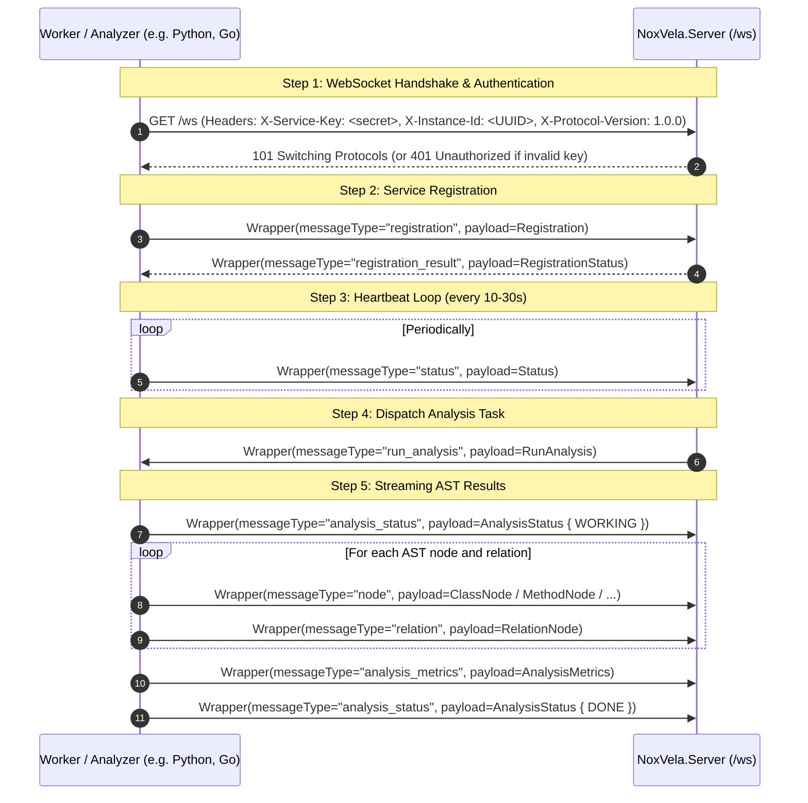
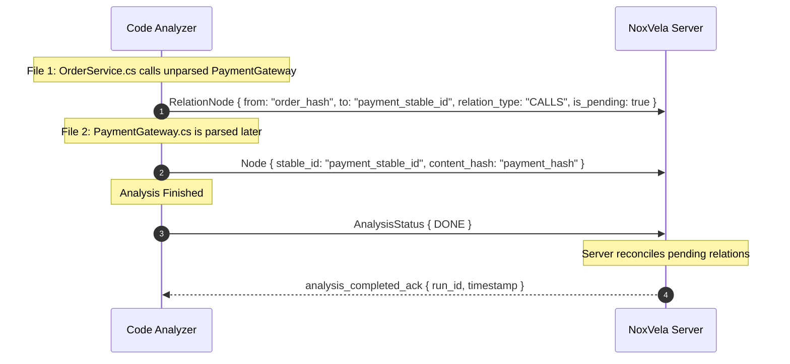

# NoxVela Protocol – Integration Guide

This document describes how to integrate an external service (e.g., a code analyzer written in Python, Go, Rust, or C#) with the core **NoxVela Server** using a transport protocol based on **bare WebSockets**.

---

## 1. Architecture and Protocol Concept

Communication between the NoxVela Server and worker services (analyzers, AI services) is built upon a bi-directional WebSocket channel. The protocol avoids heavy transport abstractions like SignalR or Socket.IO on the worker tier – it relies on standard **RFC 6455 (WebSocket)** with UTF-8 text frames.

### Key Architectural Principles

1. **Envelope Pattern (`Wrapper`)**:
   Every message transmitted over WebSocket (both client-to-server and server-to-client) is encapsulated in an envelope schema:
   ```json
   {
     "messageId": "0191ebc2-8400-7c23-881e-123456789abc",
     "sourceMessageId": "00000000-0000-0000-0000-000000000000",
     "messageType": "registration",
     "payload": "{\"instanceId\":\"...\"}"
   }
   ```
2. **Double Serialization (`payload` as a string)**:
   > ⚠️ **Important:** The `payload` field in the envelope is a **serialized JSON string** (JSON-escaped string), rather than an inlined nested JSON object.
3. **Request-Response Correlation (`sourceMessageId`)**:
   * New messages initiated by the client or server carry `sourceMessageId` set to an empty GUID (`00000000-0000-0000-0000-000000000000`).
   * Replies (e.g., `registration_result` responding to `registration`) set `sourceMessageId` to the `messageId` of the message being answered.
4. **UUID Identifiers**:
   It is recommended to generate `messageId` and `instanceId` identifiers using **UUIDv7** (or UUIDv4).

---

## 2. Connection Lifecycle



---

## 3. Message Specifications and Payloads

### A. Service Registration (`registration`)
Immediately after establishing the connection to `ws://<host>:5000/ws`, the service must send a registration message.

* **Envelope:** `messageType = "registration"`
* **Payload (`Registration`):**
  ```json
  {
    "instanceId": "0191ebc2-8400-7c23-881e-123456789abc",
    "serviceName": "PythonAnalyzer",
    "version": "1.0.0",
    "capabilities": ["AST", "Metrics"],
    "supportedLanguages": ["python"],
    "serviceType": 0,
    "poolId": "analyzer-cluster-prod",
    "serviceKey": "secret-pool-key",
    "protocolVersion": "1.0.0"
  }
  ```
  * `serviceType`: `0` = ANALYZER, `100` = AI.
  * `poolId`: (Optional) Logical cluster identifier grouping multiple worker replicas.
  * `serviceKey`: (Optional) Shared service pool key.

### B. Server Registration Response (`registration_result`)
* **Envelope:** `messageType = "registration_result"`, `sourceMessageId` = `messageId` of the registration frame.
* **Payload (`RegistrationStatus`):**
  ```json
  {
    "status": 0
  }
  ```
  * `status`: `0` = ACCEPTED, `1` = REJECTED.

### C. Heartbeat / Status (`status`)
Sent periodically by the worker (e.g., every 15 seconds) to signal liveness and report current worker load to the orchestrator.

* **Envelope:** `messageType = "status"`
* **Payload (`Status`):**
  ```json
  {
    "instanceId": "0191ebc2-8400-7c23-881e-123456789abc",
    "status": 0
  }
  ```
  * `status`: `0` (IDLE), `1` (WORKING), `2` (ERROR), `3` (COMPLETING), `4` (DONE).

### D. Analysis Task Trigger (`run_analysis`)
When a user or pipeline requests code analysis for a project, the server dispatches a task to the connected analyzer:

* **Envelope:** `messageType = "run_analysis"`
* **Payload (`RunAnalysis`):**
  ```json
  {
    "run_id": "run_0191ef90-...",
    "code_context": {
      "repository_url": "https://github.com/example/repo.git",
      "branch_name": "main",
      "commit_hash": "7f8b91a2b3c4d5e6f7a8b9c0d1e2f3a4b5c6d7e8",
      "provider": "GitHub",
      "is_public": true,
      "credentials": null
    },
    "requested_capabilities": [
      "syntax_tree_parsing",
      "call_graph",
      "metrics"
    ]
  }
  ```
  > **Note on Capabilities:** The `requested_capabilities` field communicates which specific capabilities the server or user selected for this run. Well-known analyzer capability constants (`AnalyzerCapabilities`) include: `syntax_tree_parsing`, `call_graph`, `type_hierarchy`, `metrics`, `dependency_analysis`, `memory_leak_detection`, and `security_scan`. When omitted or null, analyzers execute their default registered capabilities.

### E. Analysis Cancellation (`cancel_analysis`)
When a user cancels an analysis task via the web interface or an associated project is removed, the server dispatches a cancellation message instructing the worker to abort immediately:

* **Envelope:** `messageType = "cancel_analysis"`
* **Payload (`CancelAnalysis`):**
  ```json
  {
    "run_id": "run_0191ef90-...",
    "reason": "User requested task cancellation."
  }
  ```
  * `run_id`: Unique execution run identifier to cancel.
  * `reason`: Optional human-readable description of why the cancellation was requested.

Analyzers receiving this message should immediately trigger their internal `CancellationTokenSource`, terminate any child Git or compilation processes, clean up scratch workspace folders, and report an updated `analysis_status`.

### F. AST Node Streaming (`node`)
For every discovered class, method, field, property, etc., the service emits a `node` message:

* **Envelope:** `messageType = "node"`
* **Common Node Fields (`NodeBase`):**
  * `stable_id`: Deterministic identifier (e.g., `com.example.MyClass.myMethod`).
  * `content_hash`: Content hash used for incremental change detection.
  * `type`: Node category (`classes`, `methods`, `fields`, `properties`, `interfaces`, `enums`, `records`, `structs`, etc.).
* **Example Payload (`ClassNode`):**
  ```json
  {
    "stable_id": "MyProject.Core.UserService",
    "content_hash": "e3b0c44298fc1c149afbf4c8996fb924",
    "type": "classes",
    "is_static": false,
    "is_abstract": false,
    "is_sealed": false,
    "is_generic": false,
    "arity": 0,
    "accessibility": 6,
    "locations": [
      {
        "file_path": "src/Core/UserService.cs",
        "start_line": 10,
        "start_column": 1,
        "end_line": 85,
        "end_column": 2
      }
    ]
  }
  ```

### G. Graph Relation Streaming (`relation`)
Represents graph edges connecting nodes (e.g., inheritance, function invocations, type usage):

* **Envelope:** `messageType = "relation"`
* **Payload (`RelationNode`):**
  ```json
  {
    "id": "rel_0191ebc2_...",
    "from": "e3b0c44298fc1c149afbf4c8996fb924",
    "to": "8f4b237c9a1e05d288a9c1e7a3b4c5d6",
    "relation_type": "CALLS",
    "is_pending": false,
    "run_id": "run_0191ef90-..."
  }
  ```
  * Core relation types: `CONTAINS`, `DEFINES`, `CALLS`, `IMPLEMENTS`, `EXTENDS`, `READS`, `WRITES`, `OF_TYPE`, `RETURNS`.

### H. Micro-Batching (`nodes_batch`, `relations_batch`) and Backpressure (`batch_ack`)
For high throughput when scanning large repositories, emitting graph entities in micro-batches (e.g., 50–200 items per frame) is strongly recommended over individual `node`/`relation` frames.

* **Nodes Batch Envelope:** `messageType = "nodes_batch"`
  * **Payload (`NodesBatch`):**
    ```json
    {
      "run_id": "run_0191ef90-...",
      "nodes": [
        {
          "stable_id": "MyProject.Core.UserService",
          "content_hash": "e3b0c44298fc1c149afbf4c8996fb924",
          "type": "classes",
          "is_static": false,
          "accessibility": 6,
          "locations": []
        }
      ]
    }
    ```
* **Relations Batch Envelope:** `messageType = "relations_batch"`
  * **Payload (`RelationsBatch`):**
    ```json
    {
      "run_id": "run_0191ef90-...",
      "relations": [
        {
          "id": "rel_0191ebc2_...",
          "from": "e3b0c44298fc1c149afbf4c8996fb924",
          "to": "8f4b237c9a1e05d288a9c1e7a3b4c5d6",
          "relation_type": "CALLS",
          "is_pending": false,
          "run_id": "run_0191ef90-..."
        }
      ]
    }
    ```
* **Server Batch Acknowledgment (`batch_ack`):**
  The server responds to each batch frame with a `batch_ack` containing persistence status:
  * **Envelope:** `messageType = "batch_ack"`, `sourceMessageId` = `messageId` of the batch frame.
  * **Payload (`BatchAck`):**
    ```json
    {
      "run_id": "run_0191ef90-...",
      "batch_type": "nodes_batch",
      "count": 50,
      "status": 0
    }
    ```
    Workers can use this acknowledgment loop to implement adaptive client-side backpressure.

### I. Execution Metrics (`analysis_metrics`)
Sent upon completing the analysis pass:

* **Envelope:** `messageType = "analysis_metrics"`
* **Payload (`AnalysisMetrics`):**
  ```json
  {
    "instanceId": "0191ebc2-8400-7c23-881e-123456789abc",
    "run_id": "run_0191ef90-...",
    "started_at": "2026-09-15T18:00:00Z",
    "ended_at": "2026-09-15T18:00:05Z",
    "duration_ms": 5000.0,
    "generated_nodes": 120,
    "generated_relations": 340
  }
  ```

---

## 4. Complete Python Sample Client

The following script implements a fully working reference client in Python using the standard `websockets` library. It demonstrates:
* Proper `Wrapper` envelope construction and double JSON serialization.
* Service registration and response validation.
* Background asynchronous heartbeat loop.
* Handling `run_analysis` triggers and streaming sample AST nodes and metrics.

```python
import asyncio
import json
import uuid
from datetime import datetime, timezone
import websockets

SERVER_URI = "ws://localhost:5000/ws"
INSTANCE_ID = str(uuid.uuid4())

def make_wrapper(message_type: str, payload_dict: dict, source_message_id: str = "00000000-0000-0000-0000-000000000000") -> str:
    """Constructs a Wrapper frame with double-serialized JSON payload."""
    wrapper = {
        "messageId": str(uuid.uuid4()),
        "sourceMessageId": source_message_id,
        "messageType": message_type,
        "payload": json.dumps(payload_dict)
    }
    return json.dumps(wrapper)

async def heartbeat_loop(ws):
    """Periodically reports IDLE/WORKING status to the server."""
    while True:
        try:
            status_payload = {
                "instanceId": INSTANCE_ID,
                "status": 0  # 0 = IDLE
            }
            await ws.send(make_wrapper("status", status_payload))
            await asyncio.sleep(15)
        except asyncio.CancelledError:
            break
        except Exception as e:
            print(f"[Heartbeat] Transmission error: {e}")
            break

async def handle_run_analysis(ws, wrapper_obj):
    payload = json.loads(wrapper_obj["payload"])
    run_id = payload["run_id"]
    code_context = payload["code_context"]
    print(f"[*] Starting analysis run_id: {run_id} for repository: {code_context['repository_url']}")

    # 1. Report WORKING status (1 = WORKING)
    status_msg = {
        "instanceId": INSTANCE_ID,
        "status": 1,
        "message": "Cloning repository and parsing AST"
    }
    await ws.send(make_wrapper("analysis_status", status_msg))

    start_time = datetime.now(timezone.utc)

    # 2. Stream a sample class node (ClassNode)
    sample_node = {
        "stable_id": "MyApp.Models.User",
        "content_hash": "a1b2c3d4e5f60718293a",
        "type": "classes",
        "is_static": False,
        "is_abstract": False,
        "is_sealed": False,
        "is_generic": False,
        "arity": 0,
        "accessibility": 6,  # Public
        "locations": [
            {
                "file_path": "models/user.py",
                "start_line": 1,
                "start_column": 1,
                "end_line": 20,
                "end_column": 1
            }
        ]
    }
    await ws.send(make_wrapper("node", sample_node))

    # 3. Report execution metrics
    end_time = datetime.now(timezone.utc)
    duration_ms = (end_time - start_time).total_seconds() * 1000

    metrics_msg = {
        "instanceId": INSTANCE_ID,
        "run_id": run_id,
        "started_at": start_time.isoformat(),
        "ended_at": end_time.isoformat(),
        "duration_ms": duration_ms,
        "generated_nodes": 1,
        "generated_relations": 0
    }
    await ws.send(make_wrapper("analysis_metrics", metrics_msg))

    # 4. Report completion status (4 = DONE)
    completion_msg = {
        "instanceId": INSTANCE_ID,
        "status": 4,
        "message": "Analysis completed successfully"
    }
    await ws.send(make_wrapper("analysis_status", completion_msg))
    print(f"[+] Completed analysis run_id: {run_id}")

async def run_client():
    headers = {
        "X-Instance-Id": INSTANCE_ID,
        "X-Service-Key": "secret-pool-key",
        "X-Protocol-Version": "1.0.0"
    }
    async with websockets.connect(SERVER_URI, extra_headers=headers) as ws:
        print(f"[+] Connected to {SERVER_URI}")

        # Registration
        reg_payload = {
            "instanceId": INSTANCE_ID,
            "serviceName": "PythonSampleAnalyzer",
            "version": "1.0.0",
            "capabilities": ["AST", "Metrics"],
            "supportedLanguages": ["python"],
            "serviceType": 0,  # 0 = ANALYZER
            "poolId": "analyzer-cluster-prod",
            "serviceKey": "secret-pool-key",
            "protocolVersion": "1.0.0"
        }
        await ws.send(make_wrapper("registration", reg_payload))

        # Start background heartbeat loop
        heartbeat_task = asyncio.create_task(heartbeat_loop(ws))

        try:
            async for raw_msg in ws:
                wrapper = json.loads(raw_msg)
                msg_type = wrapper.get("messageType")

                if msg_type == "registration_result":
                    res = json.loads(wrapper["payload"])
                    if res.get("status") == 0:
                        print("[+] Registration ACCEPTED by orchestrator.")
                    else:
                        print("[-] Registration REJECTED!")
                        break
                elif msg_type == "run_analysis":
                    await handle_run_analysis(ws, wrapper)
        finally:
            heartbeat_task.cancel()

if __name__ == "__main__":
    # pip install websockets
    asyncio.run(run_client())
```

---

## 5. Canonical Hashing Standard (`StableIdFactory`)

In the NoxVela architecture, graph node keys, deduplication indices, relation edges, and incremental graph caches are indexed by deterministic cryptographic hashes computed by analyzers. To guarantee cross-language interoperability (e.g., C#, Python, Go, Rust analyzers producing identical hashes for identical code elements), all analyzers must adhere to this **Canonical Hashing Standard**.

### 5.1 Algorithm Specification
* **Hash Function**: Standard **SHA-256** (FIPS 180-4).
* **Text Encoding**: **UTF-8** without Byte Order Mark (BOM).
* **Output Format**: **64-character lowercase hexadecimal string** (`x2` formatting). Empty or null string inputs result in an empty string (`""`).

### 5.2 Canonical Hash Formulas

| Identifier Type | Method in C# SDK | Canonical Input String Formula | Description & Example |
|---|---|---|---|
| **Symbol Stable ID** | `CreateDeterministicHashId` | `"{assemblyName}::{documentationId}"` | Identifies a declared symbol across versions. If assembly is unknown, defaults to `"Unknown"`. Example: `SHA256("MyApp::T:MyApp.Models.User")` |
| **Content Hash** | `CreateDeterministicContentHashId` | `"{source_code_or_data}"` | Identifies exact syntactic content of a declaration. Example: `SHA256("public class User { ... }")` |
| **Direct Relation ID** | `CreateRelationId(..., pending: false)` | `"{fromContentHash}\|{relation}\|{toContentHash}"` | Unique key for direct graph edge connecting two resolved content hashes. Example: `SHA256("hashA\|CALLS\|hashB")` |
| **Pending Relation ID** | `CreateRelationId(..., pending: true)` | `"{fromContentHash}\|{relation}\|{toContentHash}\|pending"` | Unique key for an unresolved pending edge. Appends `\|pending`. Example: `SHA256("hashA\|CALLS\|stableIdB\|pending")` |
| **External Content Hash** | `CreateExternalContentHashId` | `"EXTERNAL_CONTENT::{externalStableId}"` | Content hash for symbols without available source code (e.g. BCL or NuGet libraries). Example: `SHA256("EXTERNAL_CONTENT::hash...")` |
| **Attribute Stable ID** | `CreateAttributeStableId` | `"ATTRIBUTE_STABLE::{parentStableId}::{attributeSignature}::{index}"` | Positionally unique attribute stable ID on a parent declaration. Example: `SHA256("ATTRIBUTE_STABLE::p1::[Obsolete]::0")` |
| **Attribute Content Hash** | `CreateAttributeContentHashId` | `"ATTRIBUTE_CONTENT::{parentContentHash}::{attributeContent}::{index}"` | Syntactic content hash for an attribute instance. Example: `SHA256("ATTRIBUTE_CONTENT::p1::[Obsolete]::0")` |

### 5.3 Test Vectors (Reference Validation)
Implementations in other languages can validate their hashing engine against these standard reference vectors:
* Symbol ID: `"NoxVela::M:NoxVela.OrderService.Checkout"` &rarr; `2f41a79b5b9fa3c6cdcdcbf8936f7002214b369d347dea07771533b0b96925a2`
* Direct Relation: `"hash_from|CALLS|hash_to"` &rarr; `e039d779a930cf5dc1d02acd9eeeac8d8d1856d782f1ce46398c8bb3eec7f48b`
* Pending Relation: `"hash_from|CALLS|hash_to|pending"` &rarr; `a29cc1034694ea1e6c6a58339e84838e1892166d9bc50abd228246d977b67810`
* External Content: `"EXTERNAL_CONTENT::ext_stable_id_123"` &rarr; `8a5e1fa17ab4f175e334bdefb83a657930803cd0f7068bbb546ad63e5d114cc0`

---

## 6. Pending Relations (`is_pending: true`) Protocol Contract

When analyzing enterprise repositories containing thousands of files, loading the entire abstract syntax tree and call graph into analyzer memory before emitting results causes high memory footprint and latency. The NoxVela protocol supports **Single-Pass Streaming Analysis** via **Pending Relations**.



### 6.1 Protocol Rules & Semantics
1. **Unresolved Target References**:
   When an analyzer traverses code referencing a type or method defined in another file (or external module) whose `content_hash` is not yet known, the analyzer does **not** buffer the edge in memory. Instead, it emits a `RelationNode` with:
   * `from`: Source node's resolved `content_hash`.
   * `to`: Target symbol's `StableId` (computed via `CreateDeterministicHashId`).
   * `is_pending`: `true`.
   * `id`: Generated via `CreateRelationId(from, to, relation_type, pending: true)`.
2. **Streaming Efficiency**:
   Allows analyzers to flush AST nodes and relations continuously via `nodes_batch` and `relations_batch` micro-batches with bounded memory consumption ($O(1)$ working set instead of $O(N)$ full graph).
3. **Server-Side Finalization**:
   Prior to acknowledging completion with `analysis_completed_ack`, the NoxVela Server automatically reconciles pending relations whose target entities were subsequently ingested during the run.

---

## 7. Constants and Enum Reference Tables

### Service Statuses (`ServiceStatuses`)
| Value | Identifier | Description |
|---|---|---|
| `0` | `IDLE` | Service is idle and ready to accept tasks |
| `1` | `WORKING` | Service is currently executing an analysis task |
| `2` | `ERROR` | Service encountered an unrecoverable failure |
| `3` | `COMPLETING` | Finalizing execution / flushing buffers |
| `4` | `DONE` | Analysis task completed successfully |
| `5` | `UNKNOWN` | Undefined state |
| `6` | `DISCONNECTED` | Status assigned by server upon disconnect |

### Symbol Accessibility (`NodeAccessibility`)
| Value | Identifier |
|---|---|
| `0` | `NotApplicable` |
| `1` | `Private` |
| `2` | `ProtectedAndInternal` |
| `3` | `Protected` |
| `4` | `Internal` |
| `5` | `ProtectedOrInternal` |
| `6` | `Public` |

---

## 8. References and Source Repositories

* **AsyncAPI 3.1 Specification**: [`spec/asyncapi.yaml`](./spec/asyncapi.yaml)
* **Interactive HTML Documentation**: [`docs/index.html`](./docs/index.html)
* **Reference C# Analyzer**: [NoxVela.CSharpAnalyzer (GitHub)](https://github.com/NoxVela/csharp-analyzer)

