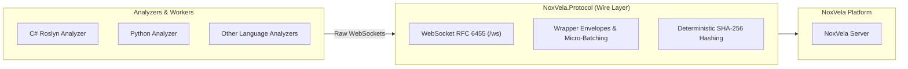
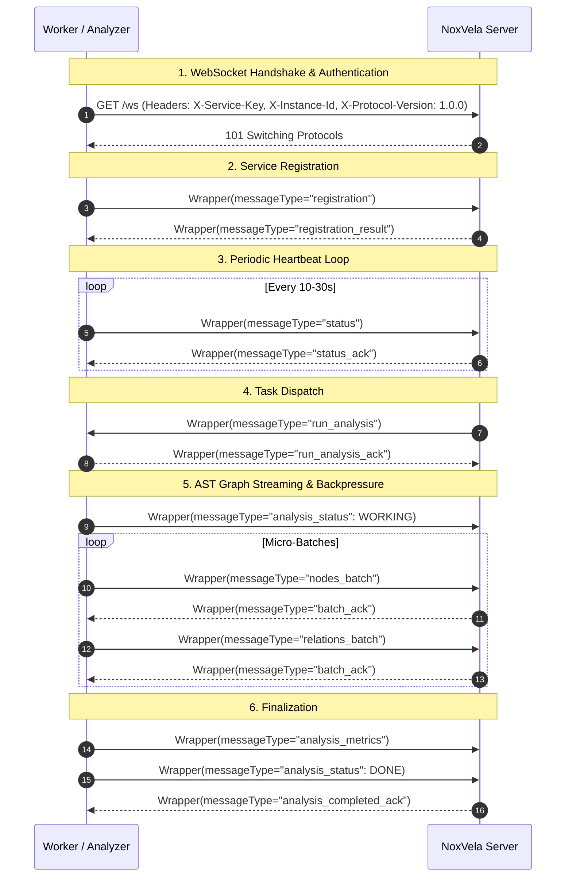

# NoxVela.Protocol

[](https://github.com/NoxVela/protocol/actions/workflows/ci.yml)
[](./spec/asyncapi.yaml)
[](https://github.com/NoxVela/protocol/packages)
[](https://noxvela.github.io/protocol/)
[](https://dotnet.microsoft.com/)
[](./LICENSE)

Shared wire protocol, data contracts, and client library for the **NoxVela** code visualization and architecture platform.

NoxVela analyzes source code repositories to generate architectural knowledge graphs (syntax trees, call graphs, type hierarchies, and dependency maps) rendered on an interactive visual canvas. Rather than bundling language parsers inside the core server, NoxVela uses a decoupled worker architecture: specialized analyzer services extract AST nodes and relations, while the core platform orchestrates runs and manages the graph model.

`NoxVela.Protocol` defines the communication standard connecting these worker services to the NoxVela Server.

---

## What This Repository Contains

1. **C# Contract Library (`NoxVela.Protocol`)**: Strongly-typed models targeting `.NET Standard 2.1` and `.NET 10.0`, supporting both `System.Text.Json` and `MessagePack` serialization.
2. **[AsyncAPI 3.1 Specification](./spec/asyncapi.yaml)**: Complete machine-readable contract defining WebSocket channels, message types, and schema validations.
3. **[Interactive HTML Documentation](./docs/index.html)**: Browser-based schema explorer and API reference generated from the AsyncAPI spec.
4. **[Integration Guide (INTEGRATION_GUIDE.md)](./INTEGRATION_GUIDE.md)**: Wire protocol specification, handshake lifecycle, error handling, and complete reference client implementation in Python.
5. **Code-First Generator (`tools/NoxVela.Protocol.Generator`)**: Roslyn-based tool that extracts AsyncAPI schemas and XML doc comments directly from C# source code.

---

## System Architecture



---

## Core Design Principles

### 1. Bare WebSocket Framing (RFC 6455)
Workers communicate with NoxVela Server at `/ws` over standard WebSockets. By relying on native RFC 6455 rather than heavyweight application-level frameworks, analyzers can be implemented in any language (C#, Python, Go, Rust, TypeScript) with zero proprietary runtime dependencies.

### 2. Envelope Pattern (`Wrapper`)
Every frame sent across the socket uses a unified `Wrapper` envelope:

```json
{
  "messageId": "0191ebc2-8400-7c23-881e-123456789abc",
  "sourceMessageId": "00000000-0000-0000-0000-000000000000",
  "messageType": "registration",
  "payload": "{\"serviceName\":\"csharp-analyzer\",\"version\":\"1.0.0\",\"protocolVersion\":\"1.0.0\"}"
}
```

- `messageId`: Unique message identifier (UUIDv7 or UUIDv4).
- `sourceMessageId`: Request-response correlation ID. Set to `00000000-0000-0000-0000-000000000000` for initial requests; responses echo the initiator's `messageId`.
- `messageType`: String discriminator matching constants in `ServiceMessagesTypes` or `ServerMessagesTypes`.
- `payload`: Serialized string (JSON) or byte array (MessagePack). Wrapping payload as a serialized string allows intermediate routers and dispatchers to inspect envelope headers without paying the CPU cost of deserializing large graph structures.

### 3. Micro-Batching and Backpressure
Emitting individual nodes or relations over separate WebSocket frames introduces high syscall and framing overhead. `NoxVela.Protocol` defines micro-batch messages (`nodes_batch`, `relations_batch`). The server acknowledges each batch with a `batch_ack`, allowing analyzers to throttle their traversal loop and avoid saturating socket buffers or database write queues.

### 4. Single-Pass Streaming via Pending Relations
In large repositories (thousands of files), building the complete AST and call graph in worker memory before sending results requires substantial RAM. The protocol supports streaming declarations file-by-file:
- If a method in `OrderService.cs` calls an unparsed class `PaymentGateway.cs`, the analyzer emits a relation with `is_pending: true` and the target's stable ID.
- Once `PaymentGateway.cs` is parsed and its node is ingested, the server reconciles the relation edge automatically.
- This allows analyzers to maintain an $O(1)$ working memory set regardless of repository size.

### 5. Canonical Deterministic Hashing (`StableIdFactory`)
Graph nodes and relation IDs must be deterministic across runs and across languages. The protocol specifies standard SHA-256 formulas (UTF-8, lowercase 64-character hex strings) for:
- Symbol stable IDs (`{assembly}::{documentationId}`)
- Content hashes (`SHA256(source_code)`)
- Direct and pending relation IDs (`{fromHash}|{relationType}|{toHash}`)

See [Section 5 in INTEGRATION_GUIDE.md](./INTEGRATION_GUIDE.md#5-canonical-hashing-standard-stableidfactory) for hashing formulas and reference test vectors.

---

## Protocol Lifecycle



---

## Usage in .NET

The `NoxVela.Protocol` C# library is published to **GitHub Packages** (`https://nuget.pkg.github.com/NoxVela/index.json`).

### Installing from GitHub Packages

Because GitHub Packages requires authentication to restore packages, you will need a GitHub Personal Access Token (PAT) with the `read:packages` permission.

1. Add the GitHub Packages source to your local NuGet configuration:

```bash
dotnet nuget add source "https://nuget.pkg.github.com/NoxVela/index.json" \
  --name "github" \
  --username <GITHUB_USERNAME> \
  --password <GITHUB_PAT> \
  --store-password-in-clear-text
```

Or add a `nuget.config` file to your repository:

```xml
<?xml version="1.0" encoding="utf-8"?>
<configuration>
  <packageSources>
    <add key="nuget.org" value="https://api.nuget.org/v3/index.json" protocolVersion="3" />
    <add key="github" value="https://nuget.pkg.github.com/NoxVela/index.json" />
  </packageSources>
  <packageSourceCredentials>
    <github>
      <add key="Username" value="%GITHUB_USERNAME%" />
      <add key="ClearTextPassword" value="%GITHUB_TOKEN%" />
    </github>
  </packageSourceCredentials>
</configuration>
```

2. Add the package to your project:

```bash
dotnet add package NoxVela.Protocol --version 1.0.0
```

### Constructing and Emitting AST Nodes

```csharp
using System.Text.Json;
using NoxVela.Protocol.Messages;
using NoxVela.Protocol.Messages.Service;
using NoxVela.Protocol.Models.Code;

// 1. Create AST code node
var classNode = new ClassNode
{
    StableId = "MyApp.Services.OrderService",
    ContentHash = "3b7c8a1e2f4d5e6a",
    Type = AllNodesTypes.ClassNodes,
    Identifier = "OrderService",
    Accessibility = NodeAccessibility.Public,
    IsStatic = false,
    Loc = 145,
    Locations = new List<CodeLocation>
    {
        new()
        {
            FilePath = "src/Services/OrderService.cs",
            StartLine = 12,
            StartColumn = 1,
            EndLine = 157,
            EndColumn = 2
        }
    }
};

// 2. Wrap into a micro-batch
var batch = new NodesBatch
{
    RunId = "run-0191ef90-8400-7c23-881e-123456789abc",
    Nodes = new[] { classNode }
};

// 3. Encapsulate in transport envelope
var envelope = new Wrapper
{
    MessageId = Guid.NewGuid().ToString(),
    SourceMessageId = Guid.Empty.ToString(),
    MessageType = ServiceMessagesTypes.NODES_BATCH,
    Payload = JsonSerializer.Serialize(batch)
};

// 4. Send over WebSocket
string jsonFrame = JsonSerializer.Serialize(envelope);
// await webSocket.SendAsync(Encoding.UTF8.GetBytes(jsonFrame), ...);
```

---

## Integrating Non-.NET Analyzers

If you are developing an analyzer in Python, Go, Rust, or another language:

1. Follow the connection handshake and payload conventions detailed in **[INTEGRATION_GUIDE.md](./INTEGRATION_GUIDE.md)**.
2. Review the reference **[Python sample client](./INTEGRATION_GUIDE.md#4-complete-python-sample-client)** demonstrating the full lifecycle: authentication, heartbeat loop, task execution, batch streaming, and metrics reporting.
3. Use the canonical SHA-256 formulas described in [Section 5](./INTEGRATION_GUIDE.md#5-canonical-hashing-standard-stableidfactory) to ensure generated symbol stable IDs match server indices.

---

## Specification & Generation Tooling

The formal AsyncAPI specification and HTML documentation are generated directly from C# models and XML doc comments using an internal generator tool:

```bash
# Build solution
dotnet build NoxVela.sln

# Regenerate AsyncAPI 3.1 specification and HTML portal (requires @asyncapi/cli)
dotnet run --project tools/NoxVela.Protocol.Generator/NoxVela.Protocol.Generator.csproj -- --html .
```

---

## Building and Verification

Prerequisites: [.NET 10 SDK](https://dotnet.microsoft.com/download/dotnet/10.0)

```bash
# Run unit, contract, and serialization tests
dotnet test NoxVela.sln

# Validate AsyncAPI specification syntax
asyncapi validate spec/asyncapi.yaml
```

---

## License

This project is licensed under the [MIT License](./LICENSE).
